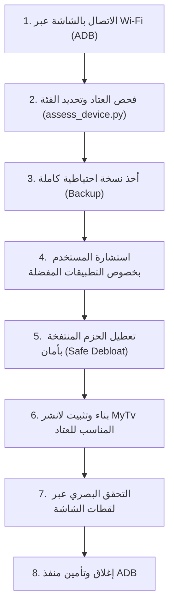

# مهارة MyTv (تلفازي) لوكلاء Antigravity

تتيح هذه المهارة لوكيل **Antigravity** العمل كفني تشغيل ذكي ومحترف لإدارة وتجريد شاشات وأجهزة التلفاز الذكية (Android TV / Google TV) من الإعلانات والحزم المتطفلة والبطيئة، واستبدال الواجهة بلانشر `MyTv` فائق الخفة المستوحى من Apple TV.

> [!IMPORTANT]
> **مراعاة البيئة العربية والأجهزة الاقتصادية**:
> نسبة كبيرة من المستخدمين في الوطن العربي يمتلكون أجهزة وشاشات بمواصفات متواضعة (ذاكرة RAM بحجم 1 جيجابايت أو أقل، معالجات رباعية ضعيفة، مساحة تخزين شحيحة، وإصدارات أندرويد قديمة، ولوحات مثل CVTE و MStar و Realtek).
> **لا تطبق إعدادات ثقيلة أو تلغي حزم عشوائية**؛ التزم دائماً بفحص العتاد وتطبيق البروفايل المناسب (`Ultra-Lite` للأجهزة الاقتصادية).

---

## بروتوكول العمل خطوة بخطوة



---

### الخطوة 1: الاتصال بالشاشة (Connect)
1. اطلب من المستخدم التأكد من أن التلفاز والكمبيوتر متصلان بنفس شبكة الـ Wi-Fi.
2. تفعيل خيارات المطور وتصحيح USB (USB Debugging):
   - الإعدادات ← تفضيلات الأجهزة ← حول ← الضغط 7 مرات على **رقم الإصدار (Build)**.
   - الرجوع للخلف ← خيارات المطور ← تفعيل **تصحيح أخطاء USB (USB Debugging)** وتصحيح الشبكة (Network Debugging إن وُجد).
3. الاتصال عبر المنفذ 5555:
   ```bash
   adb connect <TV_IP>:5555
   ```
4. نبه المستخدم بالموافقة على رسالة `"السماح بتصحيح أخطاء USB؟"` التي ستظهر على الشاشة.

---

### الخطوة 2: الفحص الدقيق وتقدير العتاد (Hardware Assessment)
قم بتشغيل أداة الفحص المدمجة لتقدير إمكانيات الجهاز بدقة:
```bash
python tools/assess_device.py <TV_IP>
```
أو للحصول على مخرجات بصيغة JSON برمجية:
```bash
python tools/assess_device.py <TV_IP> --json
```

ستقوم الأداة بتحديد فئة الجهاز:
* **Tier 1: الفئة الاقتصادية (Ultra-Budget)**:
  - RAM أقل من أو تساوي 1024 ميغابايت (أو ذاكرة متاحة أقل من 200MB)، أو مساحة متبقية أقل من 800MB، أو معالج 32-bit قديم، أو أندرويد أقل من 8.0 (SDK < 26).
  - **الإجراء الإلزامي**:
    - تطبيق بروفايل **`Ultra-Lite`** في اللانشر:
      - `reduced_motion = true` (إلغاء الحركات الثقيلة)
      - `ambient_glow = false` (إلغاء التوهج الملون الحركي لتوفير استهلاك كرت الشاشة والذاكرة)
      - `focus_overshoot = false`
      - `module_cards = false` (إيقاف البطاقات المعيارية العاملة بالخلفية لتوفير الذاكرة لتطبيقات البث)
    - **إذا كان إصدار أندرويد أقل من SDK 26**: وضّح للمستخدم أن اللانشر لا يدعم إصدارات أندرويد القديمة جداً، واقترح الاكتفاء بالتنظيف (Debloat-only) لتحسين سرعة شاشته دون تثبيت اللانشر.
* **Tier 2: الفئة المتوسطة (Mid-Range)**:
  - RAM بين 1.5 جيجابايت و 2 جيجابايت.
  - تطبيق بروفايل **`Balanced`** (حركة متوازنة، تأثيرات خفيفة، ويدجت مواقيت الصلاة والطقس).
* **Tier 3: الفئة العالية (High-End)**:
  - RAM أكبر من 2 جيجابايت.
  - تطبيق بروفايل **`High-End`** (تأثيرات زجاجية وتوهج كامل).

---

### الخطوة 3: قواعد الأمان الصارمة للشاشات العربية والاقتصادية

> [!CAUTION]
> 1. **التعطيل فقط دون الحذف**: استخدم `pm disable-user --user 0` دائماً، ولا تستخدم `pm uninstall` نهائياً. كل شيء يجب أن يكون قابلاً للاسترجاع عبر `tools/restore.sh` أو `restore.ps1`.
> 2. **حظر لمس المتاجر البديلة في شاشات AOSP**: العديد من الشاشات الاقتصادية (مثل Tornado, Changhong, Haier, Nikai) لا تملك متجر Google Play رسمي، وتعتمد على متاجر مثل Aptoide أو APKPure. **لا تعطل هذه المتاجر أبداً** وإلا لن يتمكن المستخدم من تثبيت أو تحديث أي تطبيق.
> 3. **حماية لوحات CVTE وشاشات المعالجات الصينية**: إذا وجدت حزم `com.cvte.*`، لا تعطل المشغل الأصلي إلا بعد التأكد التام من عمل المشغل الجديد وأزرار الريموت ومصادر الإدخال (HDMI).
> 4. **حماية تطبيقات البث العربية الشائعة**: تأكد من عدم المساس بتطبيقات المستخدم مثل:
>    - شاهد (Shahid - `com.mbc.shahid`)
>    - تود و بي إن (TOD / beIN - `com.tod`, `tv.beinsports.connect`)
>    - ووتش إت (WATCH IT - `com.watchit`)
>    - ستارزبلاي (STARZPLAY - `com.starzplay.android`)
>    - تطبيقات القرآن ومواقيت الصلاة و IPTV و SmartTube.

---

### الخطوة 4: الحوار التفاعلي وأخذ النسخة الاحتياطية

1. **النسخ الاحتياطي أولاً**:
   احفظ قائمة الحزم وإعدادات الجهاز في مجلد `backup/` قبل أي تعديل.
2. **سؤال المستخدم عن تفضيلاته**:
   اسأل المستخدم باللغة العربية عبر خيارات تفاعلية واضحة:
   - ما هي التطبيقات الأربعة المفضلة لديك لوضعها في الشريط السفلي (Dock)؟
   - هل تستخدم ميزة الإرسال (Chromecast / Miracast)؟
   - هل تستخدم المساعد الصوتي؟
   - هل تريد تفعيل مانع الإعلانات الخاص بـ DNS (AdGuard DNS) لحظر إعلانات التطبيقات والنوافذ المنبثقة؟

---

### الخطوة 5: تطبيق التنظيف وبناء وتثبيت اللانشر

1. تطبيق التعطيل على دفعات صغيرة مع أخذ لقطة شاشة بعد كل دفعة للتأكد:
   ```bash
   python tools/tv.py --screenshot shots/step1.png
   ```
2. ضبط ملف `launcher/app/src/main/res/values/config.xml` بحسب بروفايل الجهاز وتفضيلات المستخدم وتطبيقات الـ Dock.
3. بناء وتثبيت اللانشر:
   على أنظمة ويندوز (PowerShell):
   ```powershell
   .\launcher\build-and-install.ps1
   ```
   أو على لينكس/ماك:
   ```bash
   ./launcher/build-and-install.sh
   ```
4. التأكد من أن لانشر `MyTv` أصبح الشاشة الرئيسية:
   ```bash
   tools/tv.py "cmd package set-home-activity com.gathin.tvhome/.MainActivity"
   ```

---

### الخطوة 6: الإنهاء وتأمين الجهاز (Close ADB)
بعد اكتمال العملية ورضا المستخدم بالكامل:
1. اطلب من المستخدم الدخول لخيارات المطور وإيقاف **تصحيح أخطاء USB**.
2. التحقق من إغلاق المنفذ 5555 لحماية خصوصية الشبكة المنزلية:
   ```bash
   python tools/adb-closed.py <TV_IP>
   ```
