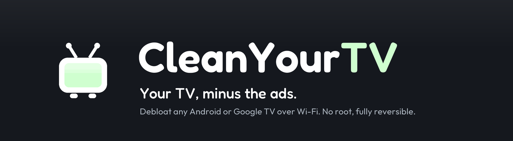

<p align="center">
  
</p>

<p align="center">
  <a href="https://github.com/bio-colab/MyTv"></a>
  <a href="https://github.com/bio-colab/MyTv/stargazers"></a>
  <a href="https://github.com/bio-colab/MyTv/network/members"></a>
  <a href="README.en.md"></a>
  <a href="LICENSE"></a>
</p>

---

# MyTv (تلفازي) 📺

> **تلفازك الذكي.. سريع، خفيف، وخالٍ تماماً من الإعلانات والتتبع.**
> 
> نظام وأدوات مفتوحة المصدر لتنظيف وتجريد شاشات وأجهزة **Android TV** و **Google TV** عبر شبكة الـ Wi-Fi، واستبدال الواجهة الثقيلة والمحشوة بالإعلانات بلانشر خفيف وأنيق بحجم أقل من **500 كيلوبايت**، مع مراعاة كاملة للبيئة العربية والأجهزة الاقتصادية متواضعة العتاد، وبدعم مباشر ومخصص لوكيل **Google Antigravity**.

---

## 🌟 لماذا MyTv؟ وما التوجه الحديث الذي يمثله؟

في السنوات الأخيرة، تحولت معظم شاشات وأجهزة التلفاز الذكية إلى لوحات إعلانية بطيئة تستهلك موارد المعالج والذاكرة في التتبع والإعلانات الموجهة وصفحات التوصيات غير المرغوبة. في الوطن العربي، تزداد المشكلة حدة لأن أغلب الأجهزة والشاشات المنتشرة لدى الفئات المتوسطة والبسيطة تأتي **بمواصفات عتادية متواضعة للغاية**:
* ذاكرة عشوائية (RAM) لا تتعدى **1 جيجابايت** (أو حتى 512–768 ميغابايت).
* معالجات رباعية ضعيفة ولوحات تجارية شائعة (مثل **CVTE**، **MStar**، **Realtek**، **Amlogic**).
* مساحات تخزين ضيقة جداً (8 جيجابايت يتبقى منها للمستخدم أقل من 1.5 جيجابايت).
* إصدارات أندرويد قديمة (Android 7 أو 8 أو 9).

**مشروع MyTv يعيد لك السيادة والتحكم الكامل في شاشتك عبر حلول عملية:**
1. **بدون روت (No Root) وبدون كابلات**: يعمل كل شيء عبر الـ Wi-Fi باستخدام بروتوكول ADB القياسي.
2. **بدون حذف نهائي للحزم**: يعتمد أمر الإيقاف المؤقت للمستخدم (`pm disable-user --user 0`)، وبالتالي يمكن استعادة أي حزمة أو إرجاع الشاشة لحالتها الأصلية بأمر استرجاع واحد.
3. **أمان وخصوصية 100%**: اللانشر كود Java أصلي نقي وصغير جداً، ولا يطلب إذن الإنترنت على الإطلاق (`No INTERNET permission`).
4. **تقدير ذكي للعتاد (Hardware-Aware)**: فحص مواصفات الشاشة تلقائياً واختيار بروفايل فائق الخفة (`Ultra-Lite`) للشاشات الضعيفة، بحيث لا تُرهق الذاكرة ولا تتعطل تطبيقات البث الأساسية.
5. **مبني لوكلاء الذكاء الاصطناعي (AI Agent Operator)**: مدعوم بمهارة مخصصة لوكيل **Antigravity** ليقود عملية الفحص والتنظيف والتحقق البصري بالنيابة عنك دون تعقيدات تقنية.

---

## 🚀 البدء السريع عبر وكيل Antigravity

إذا كنت تستخدم بيئة **Google Antigravity**:

1. **على التلفاز**:
   - توجه إلى: `الإعدادات` ← `تفضيلات الأجهزة` ← `حول`.
   - اضغط على **رقم الإصدار (Build)** 7 مرات حتى تظهر عبارة "أنت الآن مطور برامج".
   - ارجع خطوة للخلف ← `خيارات المطور` ← فعّل **تصحيح أخطاء USB (USB Debugging)** وتصحيح الشبكة إن وجد.
2. **في بيئة Antigravity**:
   - المستودع يحتوي مهارة مدمجة في [`skills/mytv/SKILL.md`](skills/mytv/SKILL.md).
   - يمكنك تفعيلها مباشرة أو نسخ الأوامر في محادثتك مع الوكيل عبر [`PROMPT.md`](PROMPT.md).
   - سيقوم الوكيل بالاتصال بالشاشة، فحص العتاد واقتراح البروفايل الأنسب، وسؤالك عن تفضيلاتك وتطبيقاتك المفضلة خطوة بخطوة.

---

## 🛠️ أداة فحص العتاد وتحديد الفئات (Hardware Assessor)

قمنا بتطوير أداة [`tools/assess_device.py`](tools/assess_device.py) خصيصاً لاكتشاف مواصفات الشاشة وتصنيفها بأمان قبل إجراء أي تعديل:

```bash
python tools/assess_device.py <عنوان_IP_التلفاز>
```

### فئات الأجهزة المعتمدة:

| الفئة | المواصفات | الإجراء والبروفايل المطبق |
|---|---|---|
| **Tier 1: الفئة الاقتصادية (Ultra-Budget)** | RAM ≤ 1GB، مساحة متبقية < 800MB، معالج 32-bit أو أندرويد قديم | تطبيق بروفايل `Ultra-Lite`: إيقاف التمويه الزجاجي والتوهج الديناميكي والحركات الثقيلة لتوفير الرام بالكامل لتطبيقات البث. حظر لمس المتاجر البديلة (Aptoide/APKPure) في الشاشات غير المعتمدة من جوجل. |
| **Tier 2: الفئة المتوسطة (Mid-Range)** | RAM بين 1.5GB و 2GB، مساحة جيدة | تطبيق بروفايل `Balanced`: موازنة ذكية بين جماليات التصميم وسرعة الاستجابة، مع ويدجت مواقيت الصلاة والطقس الخفيف. |
| **Tier 3: الفئة العالية (High-End)** | RAM > 2GB، معالج قوي ومساحة وفيرة | تطبيق البروفايل الكامل: مؤثرات زجاجية تفاعلية، توهج لوني يتبع أيقونة التطبيق، وبطاقات إضافية كاملة. |

---

## 🛡️ قواعد أمان صارمة تميز MyTv

* **حماية تطبيقات البث العربية**: تتعرف الأداة تلقائياً على تطبيقات مثل:
  - شاهد VIP (`com.mbc.shahid`)
  - تود و بي إن سبورتس (`com.tod`, `tv.beinsports.connect`)
  - WATCH IT (`com.watchit`)
  - STARZPLAY (`com.starzplay.android`)
  - مشغلات IPTV وتطبيقات القرآن الكريم و SmartTube.
  وتمنع تعطيلها بأي شكل.
* **حماية شاشات اللوحات الصينية الشائعة (CVTE / Realtek / MStar)**:
  العديد من شاشات الشرق الأوسط (مثل Tornado, Haier, Skyworth, Changhong, Condor, Star-X) تدمج قائمة مصادر الـ HDMI وأزرار الريموت مع برمجيات المصنع. تحرص أدواتنا على حماية هذه الخدمات لضمان استمرار عمل منافذ التلفزيون والأزرار دون انقطاع.
* **الاسترجاع في أي وقت (Restore)**:
  إذا أردت العودة للواجهة الأصلية في أي لحظة، يكفي تشغيل أمر واحد:
  ```bash
  tools/restore.sh
  # أو على ويندوز PowerShell:
  .\tools\restore.ps1
  ```

---

## 🎨 الثيمات والإضافات (Themes & Add-ons)

* **ثيم Ultra-Lite المخصص للأجهزة الاقتصادية**: [`themes/ultra-lite`](themes/ultra-lite) يوفر واجهة داكنة مريحة للعين وفائقة السرعة خالية من أي استهلاك زائد للموارد.
* **ثيمات متنوعة**: زجاجية، طبيعية، والوضع الليلي، يمكن تطبيقها وتغييرها دون الحاجة لإعادة بناء التطبيق عبر `tools/theme.sh` أو `tools/theme.ps1`.
* **إضافات مستقلة (Module Cards)**: بطاقات إضافية (مثل مواقيت الصلاة في [`addons/prayer-times`](addons/prayer-times)، الطقس، مانع الإعلانات DNS) تعمل كوحدات منفصلة تتواصل مع اللانشر محلياً دون منحه صلاحيات إنترنت.

---

## 📂 خريطة المستودع (Repo Structure)

| المسار | الوصف |
|---|---|
| [`skills/mytv/SKILL.md`](skills/mytv/SKILL.md) | مهارة وكيل Antigravity الكاملة لتشغيل وإدارة التلفاز وفحص العتاد. |
| [`tools/assess_device.py`](tools/assess_device.py) | أداة فحص الذاكرة والمعالج والتخزين وتحديد بروفايل الجهاز وحماية البرامج الإقليمية. |
| [`PROMPT.md`](PROMPT.md) | الأوامر الإرشادية والتفاعلية للوكيل الذكي باللغتين العربية والإنجليزية. |
| [`launcher/`](launcher/) | كود اللانشر الأساسي بلغة Java النقية، يدعم العربية وRTL وخفيف جداً (< 500KB). |
| [`tools/`](tools/) | أدوات مساعدة عبر ADB (الاتصال، أخذ لقطات شاشة، النسخ الاحتياطي، الاسترجاع، قياس الأداء). |
| [`addons/`](addons/) | تطبيقات البطاقات الإضافية المستقلة (مواقيت الصلاة، الطقس، المؤقت، التحكم). |
| [`themes/`](themes/) | ملفات الثيمات والخلفيات الجاهزة (بما فيها ثيم `ultra-lite`). |
| [`examples/`](examples/) | سجلات وقوائم إزالة الحزم لأكثر من 260 طراز شاشة تم اختبارها. |

---

## 🤝 المساهمة والتطوير

المشروع مفتوح المصدر بالكامل تحت رخصة MIT. نرحب بمساهمات المطورين العرب في:
1. إضافة وتحديث ملفات الشاشات المنتشرة محلياً في مجلد `examples/`.
2. تطوير بطاقات وإضافات جديدة تخدم المستخدم العربي.
3. تحسين ودعم موديلات الشاشات الاقتصادية واللوحات المدمجة.

الرابط الرسمي للمستودع: [https://github.com/bio-colab/MyTv](https://github.com/bio-colab/MyTv)
